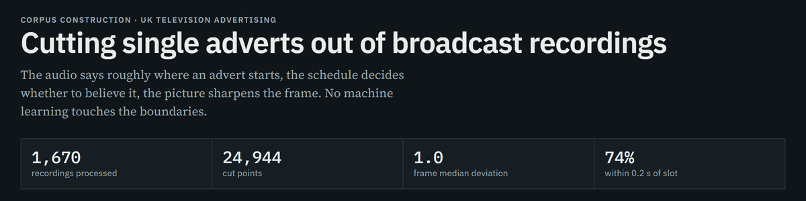
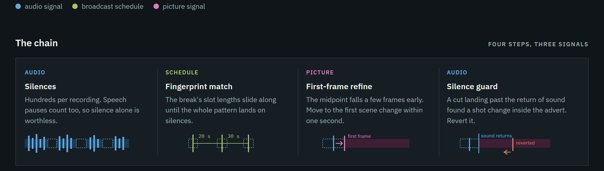
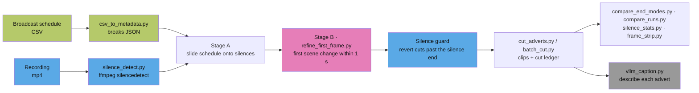

# Advert boundary detection — silence + scene-change pipeline



**Version 1.8** (15 Oct 2026)

The recordings and their metadata belong to the BFI National Archive and are not in this
repository. In the commands below, `$SRC` stands for the directory that holds them.

Deterministic segmentation of individual television adverts from full-programme
recordings, using the broadcast schedule as a prior. No machine learning is used to
find the boundaries: `ffmpeg` detects the absence of audio, and a scene-change filter
locates the first frame. A vision-language model is applied only afterwards, to
describe the content of each extracted advert.

That separation is the point. Corpus construction is deterministic and reproducible;
interpretation is where the model enters.

**Results.** The latest full run (15 October 2026) processed 1,669 recordings and
produced 30,632 cut points. Each clip is compared with the length stated in its own advert
identifier: **94.5%** are within 0.2 s, leaving aside the last clip of each break (83.2% of
all clips), and every year from 2020 to 2026 falls between 81.6% and 84.7%. 75.1% of the
unique adverts in the metadata were obtained at least once. The first full run, in
September and reported in Chapter 4 of the thesis, gave 83.0% and 73.9%.

Project pages: <https://sh-skylar-liu.github.io/advert-silence-boundary/>. Figures, and how
each change moved them, are in [docs/results_2026-10.md](docs/results_2026-10.md); the
method and the settings used for each run are in [docs/method.md](docs/method.md). The
October options are off by default, so older commands keep their meaning.

## How it works





Blue steps use the audio, green the schedule, pink the picture. The boundaries are fixed
before any model runs; the vision-language model (grey) only describes finished clips.

---

## Documentation

| File | Contents |
|---|---|
| [docs/method.md](docs/method.md) | Method, settings, batch reproduction, design notes, known limitations |
| [docs/results_2026-10.md](docs/results_2026-10.md) | Current figures: the September full run and the October sample tests |
| [analysis/ch04_results.ipynb](analysis/ch04_results.ipynb) | Notebook recomputing Table 4.6 of the thesis from summary data ([static HTML](docs/ch04_results.html)); the data are hand-transcribed, see [analysis/data/README.md](analysis/data/README.md) |
| [docs/results_2026-09.md](docs/results_2026-09.md) | Measurement log for August–September 2026, kept as a historical record |
| [docs/pipeline_explainer.html](docs/pipeline_explainer.html) | Single-page interactive walkthrough (open in a browser) |
| [CHANGELOG.md](CHANGELOG.md) | Version history |

## Repository layout

```
src/
  # pipeline
  csv_to_metadata.py      schedule CSV -> metadata JSON (break grouping, advert starts)
  silence_detect.py       Stage A: silencedetect + schedule alignment (importable)
  refine_first_frame.py   Stage B: first scene change within 1 s, two backends
  cut_adverts.py          one recording: align, refine, plan/cut clips, write the ledger
  batch_cut.py            many recordings: parallel, resumable, one ledger per recording
  # evaluation
  compare_end_modes.py    ablation over one or more ledgers: variants A / B / C
  compare_runs.py         two runs compared per recording, plus the silence-end check
  silence_stats.py        silence lengths vs. the one-second refinement window
  frame_strip.py          every frame around a cut point as one page, for ground truth
  survey_silence.py       stratified sample by channel x year; where does the cue hold?
  loss_audit.py           where scheduled adverts are lost, accidental-match test, precision by group
  refine_check.py         re-run Stage B on frame-checked cut points and compare with the truth
  show_placeholders.py    addressable-advertising placeholder records and where their slots sit
  # captioning (annotation stage, not part of segmentation)
  vllm_caption.py         captioning client + concurrency benchmark (standard library only)
analysis/
  ch04_results.ipynb      Table 4.6 recomputed from summary data; data/ holds the summaries
examples/
  example_cut_ledger.csv  synthetic ledger so the ablation runs without archive data
docs/                     see the table above
```

The scripts import each other by plain module name, so run them from `src/` or as
`python3 src/<script>.py`; do not move them into subfolders.

## Requirements

`ffmpeg` and `ffprobe` on `PATH`, and Python 3.10+. **The ffmpeg backend needs no Python
packages.**

The scenedetect backend needs PySceneDetect and OpenCV. Install the headless OpenCV build
only, into a virtual environment on local disk (imports stall when a venv lives on NFS):

```bash
uv venv ~/venv-scd --python 3.13
uv pip install --python ~/venv-scd/bin/python -r requirements.txt
```

[requirements.txt](requirements.txt) pins `scenedetect==0.7.1` and
`opencv-python-headless==5.0.0.93`.

Never install `opencv-python` and `opencv-python-headless` into the same environment.

## Reproducing

### One recording

```bash
# 1. schedule CSV -> metadata JSON (only needed if you do not already have one)
python3 src/csv_to_metadata.py "2024-03-26_ITV1HD.csv" -o breaks.json

# 2. inspect the silence structure of a recording, and how the schedule aligns to it
python3 src/silence_detect.py RECORDING.mp4 --metadata breaks.json

# 3. plan the cuts without writing any video, and save the ledger
python3 src/cut_adverts.py RECORDING.mp4 --metadata breaks.json \
    --outdir /tmp/cuts --cut-csv plan.csv --backend ffmpeg --dry-run

# 4. reproduce the A/B/C ablation from that ledger (no re-decoding needed)
python3 src/compare_end_modes.py plan.csv --per-clip

# 5. cut for real once the plan looks right
python3 src/cut_adverts.py RECORDING.mp4 --metadata breaks.json \
    --outdir /path/to/output --cut-csv plan.csv --backend ffmpeg
```

The code defaults are not the settings used in the thesis. In particular, break acceptance
defaults to the looser rule (`--min-match-rate 0.5` with boundaries filled from the
schedule), which was tested and rejected; the thesis runs use `--min-match-rate 1
--no-fill-missing`. The full command for each run is in
[docs/method.md](docs/method.md#settings-used-for-each-run).

The ablation runs out of the box on the bundled example:

```bash
python3 src/compare_end_modes.py examples/example_cut_ledger.csv
```

Batch runs over many recordings, and the exact commands behind the published figures,
are in [docs/method.md](docs/method.md#reproducing-the-batch-runs).

---

Developed by Shihan Liu, King's College London × BFI collaborative PhD.
