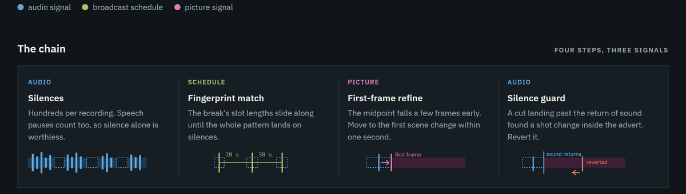

# advert-silence-boundary

For my PhD I need to extract individual adverts from continuous UK television
recordings held by the BFI National Archive. This repository contains the scripts
I use to find the cuts. Chapter 4 of my thesis describes the method.

[Project page](https://sh-skylar-liu.github.io/advert-silence-boundary/) ·
[Pipeline explainer](https://sh-skylar-liu.github.io/advert-silence-boundary/pipeline_explainer.html)



## The idea

A pause in speech can look like a join between adverts. I use the pattern of
scheduled lengths in a break, say 30, 20 and 30 seconds, to find the joins.
I keep the break only if every boundary matches a silence.

The schedule and the recording do not start at the same moment, so the code also works
out the offset between them. It trusts an offset only when at least two breaks agree on
it within five seconds. Each break is then looked for near the place that offset
predicts.

The middle of a silence usually comes a few frames before the new advert appears. So the
code then looks at the picture and moves each cut to the first visible change. If that
change comes more than 80 ms after the sound returns, it has probably caught a shot
inside the advert, and the cut goes back to the middle of the silence.

No machine learning is used to decide where the cuts go.

## What you need

You give the code a recording (`.mp4`) and the schedule for it. It gives you back a cut
plan, a spreadsheet with one row per advert showing where it starts and ends. If you want,
it also writes each advert out as a separate video clip.

The recordings and the schedule belong to the BFI National Archive and are not in this
repository. There is a small made-up example in `examples/` so you can see what a cut plan
looks like.

## Trying it

You need Python 3.10 or newer and FFmpeg. Then install the two Python packages:

```bash
pip install -r requirements.txt
```

To plan the cuts for one recording:

```bash
python src/cut_adverts.py path/to/recording.mp4 \
    --metadata path/to/recording_metadata.json \
    --outdir path/to/output --cut-csv path/to/output/cut_plan.csv \
    --clean-schedule --own-channel --align recording \
    --backend scenedetect --min-scene-len 1 --max-past-silence-end 80 \
    --refine-from silence --refine-mute-frames 6 --correct-video-start \
    --min-match-rate 1 --no-fill-missing --dry-run
```

`--dry-run` writes the plan without cutting any video. Take it out when you want the
clips. `--min-match-rate 1 --no-fill-missing` is the strict rule I use, and
`--align recording` turns on the shared offset described above. For a whole folder of
recordings there is `src/batch_cut.py`, which takes the same options. The settings behind
each run in the thesis are in [docs/method.md](docs/method.md).

## Where it stands

The 15 October 2026 dry run processed 1,669 recordings and produced 30,632 planned
clips. Of the 30,630 with a stated length, 83.2% were within 0.2 seconds of it, rising
to 94.5% when the last clip of each break is left aside. At least one clip was planned
for 14,189 unique adverts (75.1% of the cleaned schedules and 71.2% of the delivered
identifiers). The details are in
[docs/results_2026-10.md](docs/results_2026-10.md).

The percentages measure agreement with stated lengths. I checked cut positions
by eye on 19 cuts as a set, plus individual cases.

The code ends the last advert at the first silence more than eight seconds after
its aligned schedule start. A pause within the advert can end the clip early.
In October, 14.4% of planned last clips were more than five seconds short.
Short breaks can match the wrong place, and some scheduled breaks are absent
from the recording.

## Get in touch

I am Shihan Liu ([SH-Skylar-Liu](https://github.com/SH-Skylar-Liu) on GitHub). If you
have a question or spot a problem, please open an issue.
